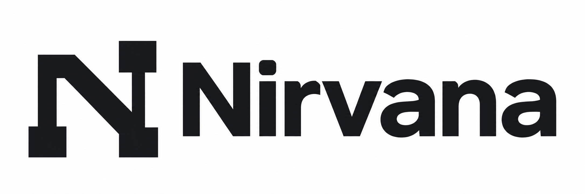

# Nirvana



x86-64の機械語からCを生成するデコンパイラ。命令デコーダ、IR、CFG解析、C出力をRustの標準ライブラリだけで実装しています。

## 使い方

実行例はLinux x86-64向けです。RustのstableツールチェーンとCコンパイラ（`cc`）を使います。

```sh
cc -O2 -c tests/fixtures/cases/diamond.c -o /tmp/nirvana-diamond.o
cargo run --release -- /tmp/nirvana-diamond.o --emit readable-c
```

既定では`fixture`関数を読みます。別の関数は`--symbol NAME`で指定します。
IRやCFGの出力、生バイト列の入力は[CLIと対応範囲](docs/machine-frontend.md)を参照してください。

## 出力例

上の例の関数本体から抜粋:

```c
value = read64(input.field_0);
value = value <= 9 ? value * 3 : value + 20;
write64(input.field_8, value);
return value;
```

`read64`・`write64`は生成Cに含まれる境界検査付きのメモリアクセスです。
生成関数はゲストメモリの配列とアドレス範囲を受け取ります。

## 対応範囲

入力は、関数シンボルとサイズを持つELF64の`.o`ファイルです。
整数演算・比較・分岐・スタック操作の一部を扱い、`if/else`やループを復元します。
構造化できない制御フローは`goto`で出力します。

開発中のため、実行形式のバイナリ、再配置の解決、関数呼出し、間接分岐、SIMDは未対応です。
元の変数名や型の復元は未対応です。

## 開発

```sh
cargo test
cargo clippy --all-targets -- -D warnings
cargo fmt --check
```

[ドキュメント](docs/README.md)に設計・実行モデル・検証方法をまとめています。
テスト入力の追加と生成方法は[C fixtures](tests/fixtures/README.md)を参照してください。
