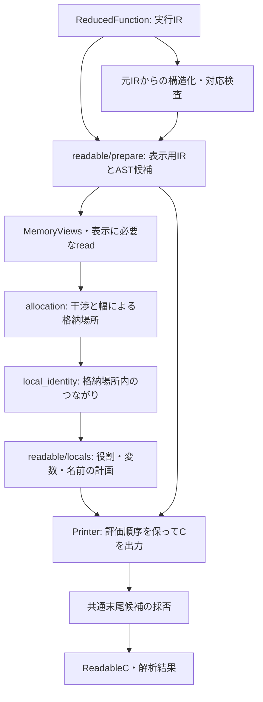

# Cバックエンドの境界と変数のまとまり

これは変数計画の分離までの設計記録です。後続の[定義webによる分離](definition-webs.md)では、
改名IRの独立した対応検査と、元の構造証拠・表示用の構造証拠の分離を追加しました。

基準は `e70faaa`。今回は、格納場所の共有と表示上の変数のまとまりを分け、
入力の一時値に後段のcounter/limitの名前が付く問題を扱いました。
IRの意味、checked memory、fault、既存の構造certificateの対象を維持します。

## 責務の分離



| 層 | 持つ責務 | 保持する条件 |
| --- | --- | --- |
| `readable/prepare.rs` | 幅解析、表示式の正規化、compact、元のASTと共有候補の準備 | 正規化後に依存解析。構造化の検査は元の還元IRに対して行う |
| `allocation.rs` | 生存性・干渉・コピーに基づく共有可能な格納場所 | 入力を共有しない。同時に必要な値を衝突させない。幅を混ぜない方針は呼出側 |
| `local_identity.rs` | 同じ格納場所の中にあるコピー・算術更新のつながり | 入力された色の部分集合だけを返す。別の色を結合しない |
| `readable/locals.rs` | 正の役割の根拠があるまとまりを分離し、最終の役割・幅・名前・slotを決める | 共有可能性と命名方針を混ぜない。入力slotとlocal slotを分離する |
| `Printer` | 式、メモリアクセス、制御構造、候補の描画 | 計画を読み取る。Load・Select・storeの検査順を保つ |

`PreparedFunction`と`LocalPlan`は内部型です。`ReadableOptions`の呼出し方法は変えず、
`ReadableC.local_plan`に`LocalPlanStats`を追加しました。
`storage_slots`は元の割当て数、`identity_groups`はつながりの候補数、
`local_variables`は最終宣言数、`split_storage_groups`は分割した元の色の数です。
`identity_groups=None`は解析の無効化または上限等による不採用で、成功を意味しません。

## なぜ同じ格納場所を同じ変数としないのか

`sum -O2`では、入力の読出しとループカウンタが干渉せず、一つのC変数へ格納できました。
その結果、入力を読んでマスクする最初の一時値までcounterと表示していました。
今はその値を分けます。これは元ソースの変数名を推測した結果ではありません。

```c
value0 = read64(input.field_0);
limit = value0 & 7;
counter = 0;
```

`early-exit-chain -O2`では、初期のバイト値とループ上限も分離します。
3→4個、7→8個のlocalになるため、最少宣言数とは別の判断です。

```c
value6 = read8(input.field_24);
accumulator0 = read64(input.field_0);
accumulator0 = value6 + accumulator0;
/* ... */
limit = (value4 & 3) + 1;
```

`refine`は同じ色の代入先と、コピー・算術rootのレジスタを結びます。
Add/Mul/And/Or/Xorは両側、Sub/Shl/Shrは左側だけをたどります。
Loadのアドレス、Selectの枝、比較式を同じ値のつながりとして扱いません。
これは構文に基づくまとまりであり、値の等価性や元ソースの変数同一性を意味しません。

最終方針では、独立したまとまりの役割を先に解析し、元の色と役割をキーに分けます。
同じ役割のまとまり同士と、匿名のまとまり同士はそれぞれ元の色内で共有します。
これにより、同じポインタの再読ごとに宣言を増やすことを避けます。最後に最終slotで役割解析をやり直します。
読み手に意味を伝えるための分割で、命令削除や実行速度の最適化ではありません。

## 正しさと失敗の扱い

共有可能な色を分割するだけなら、新しい変数同士の干渉は作りません。
consumerも、全対象が存在し、groupが範囲内かつdenseであり、一つのgroupが複数の色を跨がないことを検査します。
同じ役割や匿名のまとまりを再び共有する場合も、元の色をkeyに残します。
解析失敗時は共有結果をそのまま使い、途中までの結果を採用しません。

対象4,096レジスタ、命令と代入100,000点、式深さ128、work 1,000,000を上限とします。
到達しない命令・除外レジスタ・メモリ宛先・controlの式も、再帰的な探索前に検査します。
式を評価せず、元のProgram・命令位置・代入順・CFG・ASTを書き換えません。
元IRと構造化ASTの既存certificateも、元の対象を保持します。

純粋な前処理の切出しだけを先に実装し、対応53構成と拒否7構成で
CLIの終了値・stdout・stderrが変更前とbyte単位で一致することを確認して独立コミットにしました。
命名の変更はその後の別コミットです。

## この段階の残件と次の段階

この段階では、一つの仮想レジスタが複数の定義に使われる場合、その内部は分割しませんでした。
後続のdefinition-web passが、この定義と読出しの対応を扱います。
今回のつながりはSSA・reaching definitions・元変数の完全回復ではありません。
本格的な定義ごとの分離には、命令位置・逐次代入位置・各read/writeに対応を持つ解析と、
その対応を保つ構造化への受渡しが必要です。現在のIf/Returnは元のcontrol位置を独立のIDで持たないため、
後続の実装はIRを改名して対応検査を行い、改名後のIRから表示ASTを構造化し直す方針にしました。

展開された別形のループを同じソースループへ戻すことも別問題です。
停止・整数の折返し・メモリalias・中間faultの観測を含めた関係を検証できる段階で扱います。
今回のまとまりや名前を、その証明の代わりに使いません。

## 検証記録

同じ31ソース（既存20＋recovery 11）のO0/O2、62構成中の同じ55構成で比較しました。
GCC 13.3.0、C11・Wall/Wextra/Werror/pedantic・fno-ltoを共通にし、前後110本のCをコンパイルしています。
未対応の再配置7構成は前後とも拒否し、新たなskipはありません。

| 計測 | 基準 | 最終版 |
| --- | ---: | ---: |
| 数値local宣言 | 191 | 219 |
| 役割名のあるlocal | 24 | 46 |
| 関数内token | 19,437 | 19,521 |
| 宣言3token/個を除いたtoken | 18,864 | 18,864 |
| 関数本文byte | 98,641 | 99,388 |
| local間の単純コピー | 27 | 27 |
| for更新節 | 6 | 6 |
| goto / label | 14 / 12 | 14 / 12 |
| mask / cast | 130 / 34 | 130 / 34 |

Counter/Accumulator/Limitの個数は7/11/5で変わらず、そのまとまりから無関係なメンバを除きました。
Addressの役割を付けられるlocalは1→23です。名前の個数は元ソースの復元正解率を表しません。
宣言が28個増えることを許容し、用途の異なる値を区別する方針です。実行速度やコード縮小の改善は主張しません。

初期案は役割のある全componentを個別に表示し、localが232個になりました。
同じ役割のcomponentを元の色内で共有する方式では219個となり、専用のnative回帰検査も通ります。
この不採用案の結果は`component-per-role-comparison/`に残しました。

## for認識に見つかった依存と修正

変数を分けた直後は`nested-loops -O0`の内側forがwhileへ戻りました。
以前の認識が、条件で読む数値と更新時のポインタが同じslotを使う偶然を根拠にしていたためです。
変数の誤ったまとまりを復活させる方針は採りませんでした。

`for_loop`に、条件前のmemory readと、末尾のreload・定数加減算・storeの構文を対応させる補助解析を追加しました。
式は上限付きのinterned DAGとし、同じアドレス構文・アクセス幅・ゼロ以外の定数更新を照合します。
このDAGは一致候補を探すためだけに使い、memoryの値やポインタが不変であるという仮定には使いません。
borrowしたsetup/body/updateの式や順序も変えません。

同じ機械語で全レジスタのslotを別々にした検査でも、認識は0→1件になります。
bodyがポインタ格納先やcounterを書き換える場合、reloadのfault、アドレスや幅の不一致、
ゼロ更新・非affine更新、上限0..79の各停止位置を回帰検査に含めました。
新解析は4,096 symbol・work 65,536で打ち切り、失敗しても従来の有効なanchor探索を保ちます。
早いcontinue・非局所転送・入れ子・複数Loadの制約と、元の16代入/16Stepの上限も維持します。

## 最終の検証と再現

370テスト（通常361＋任意Z3 9）、全targetのClippy警告ゼロ、rustfmt、diff検査が通りました。
局所の解析5テストに、任意初期値でpoisonした別レジスタbankを使う5,400組の比較を含めます。
元の割当て・分割後の割当てをそれぞれ元IRと比較し、正常終了/fault/中断、全メモリ、命令traceと位置、
割当て対象外のレジスタを照合します。元の色を跨がないこと・網羅性・denseなIDも別に検査します。

for認識は17テストで、元のNode実行と借用範囲からの実行を比較します。
native Cの専用回帰には、初期バイト値がlimitの名前を継承しないことと、
同じ役割のポインタ再読が一つのAddress localを共有できることを追加しました。
viewの有無・二つの表記・O0/O2で、最初のfaultアドレスと停止前の全バイトも照合します。

| source corpus | 実行比較 |
| --- | --- |
| 既存20ソース | 33/40構成 × 63入力 = 2,079 |
| recovery 11ソース | 22/22構成 × 69入力 = 1,518 |
| 固定seedの生成8ソース | 16/16構成 × 67入力 = 1,072 |
| 合計 | 71/78構成、4,669入力比較 |

`two-phase-loops.c`を追加し、二つの異なる上限と更新値・終了後の状態を確認しました。
元Cとの比較は返り値と4状態ワード、readable CとIRの比較ではstackを含む64KiB全体のdigestも対象です。
生成16構成のUBSan付き1,008入力比較も診断なしで一致しました。
有限入力の結果は全入力の証明ではなく、既存のSMTもC表示全体を証明しません。

| コミット | 区切り |
| --- | --- |
| `0ce1a6d` | 独立した二段階ループのC fixture |
| `df8729a` | 出力byte一致を確認した前処理の抽出 |
| `bbfbc87` | boundedな格納場所内のつながり解析 |
| `e296ee0` | LocalPlanと変数の意味に基づく分割 |
| `d830b80` | 名前の偶然に依存しないメモリ更新のfor認識 |
| `35ac826` | 同じ役割同士の共有とnative回帰検査 |

```sh
cargo test --test local_identity --test for_loop --test c_evaluation
NIRVANA_Z3=target/verification-venv/bin/z3 \
  NIRVANA_RECOVERY_ARTIFACTS=target/value-lifetimes/generated \
  cargo test --all-targets -- --include-ignored
cargo build --bin nirvana
python3 tools/compare_readable_output.py \
  --before /path/to/e70faaa/nirvana --out target/value-lifetimes/comparison
python3 tools/validate_recovery_artifacts.py \
  --artifacts target/value-lifetimes/generated --out target/value-lifetimes/ubsan
```

`target/value-lifetimes/`に基準ソースとCLI、前後のC・機械語・計測JSON、全テストログ、
LocalPlanの例、全slotを分けたfor認識のprobeとハッシュmanifestを残しています。
一時snapshotは、許可した範囲の差分だけであり、対応するコミットへ反映済みであると照合して削除しました。

