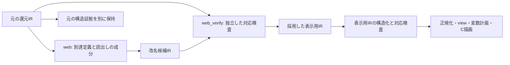

# 定義と読出しを結ぶwebによる変数分離

基準は`a5d619c`です。今回の問いは、一つの仮想レジスタが別々の用途に再利用されても、
各読出しに届く定義を混同せず、表示用IRのレジスタを分けられるかです。
前段の算術還元、checked memory、命令位置とCFGを変えないことを条件にします。

## 変換と検査を分ける



候補を作る処理と検査器は、互いのアルゴリズムや内部の表を利用しません。
候補が上限内で作れ、対応検査を通り、利用できた構造化を失わない場合だけ表示用IRへ渡します。
それ以外は従来のIRを使います。元のReducedFunctionは変更しません。

## 定義の成分を求める

到達する各レジスタについて、関数入口の定義と、各逐次代入の定義を区別します。
CFGで到達定義の集合を固定点まで求め、ある読出しへ届く同じレジスタの定義を結びます。
この連結成分をdefinition-use webと呼びます。分岐の両側から読出しへ届く値や、
ループの初回と後続回の値は、必要に応じて同じ成分になります。

- 読出しは代入先を書き換える前の状態で扱い、controlは全代入の後に扱います。
- memory宛先、RHS、Loadアドレス、Selectの全枝を構文上の読出しとして扱います。
- 入口への後方辺があっても、初回の入口定義を残します。
- 読まれる入口の成分は元のレジスタ番号を保ち、外部の引数番号を変えません。
- ほかの成分には未使用の番号を与えます。一つの有用な成分しかなければ元の番号を保ちます。

定数・演算・Load/Store幅・式の順序・代入順・命令位置・分岐先は変えません。
到達しない命令はそのまま保持します。条件の実現可能性や、メモリの値を使う解析ではありません。
Selectの両枝なども調べるため、実際の実行より保守的に成分が結び付く場合があります。

## 改名の対応を独立に検査する

`web_verify`は元IRと候補IRを直接比較し、レジスタ番号以外の構文が同じことを検査します。
その後、`(元のレジスタ, 候補のレジスタ)`という対応が、その地点へ届く全経路で成立するかを求めます。
候補の追加レジスタの初期値は任意であり、ゼロ初期化を前提にしません。

入口では同じ番号同士だけを対応させます。入口へ戻る辺でも、この初期条件との共通部分を取ります。
他のブロックはTOPから始め、前任からの共通部分と逐次代入の効果を固定点まで反映します。
代入では、元の書込み先または候補の書込み先により失われる対応を消し、その書込み先同士を対応させます。
収束後の状態から、各読出しが書込み前の有効な対応を使っていることを確認します。

これにより、同じ構文の式が同じ値を読み、同じ条件とメモリアクセスを行うための関係を検査します。
checked memoryの失敗時は代入が完了せず、そこまでの書込みと最初のfaultが観測されます。
最終のレジスタbank全体の同一性は要求しません。表示変数へ分けたレジスタの保存場所は観測対象外です。
この検査は元の機械語のリフトや、最終C表示全体の検証ではありません。

## 証拠の対象を混ぜない

`ReadableC.structure_evidence`は引き続き元の還元IRに対する構造化の結果です。
改名したIRに対する構造化は`display_structure_evidence`へ別に記録します。
`web_recovery`は未変更・解析不可・対応拒否・構造化への退避・描画失敗からの退避・採用を区別し、
採用した場合はwebの集計と独立した検査結果を保持します。
幅解析、view、表示に必要なread、LocalPlanは、すべて同じ採用済みIRを使います。

これは一つのレジスタ内の定義を扱う段階ですが、元ソースの変数を完全に復元したことにはなりません。
同じ成分へ合流する定義、C表示用の共有、元の名前・型の推定は別の問題です。
展開済みループの統合、memory SSA、命令や算術の書換えも今回の対象にはしません。

## fixtureと検証

`branch-lifetimes.c`は、別々の定義が条件分岐で合流した後にループへ進む独立した元Cです。
O0/O2のliftを必須とし、既存パイプラインで69入力ずつの一致を先に確認しました。
専用IRでは、入口のポインタ引数に使ったレジスタをカウンタへ転用し、
引数とlocalのcounterが分かれることと、途中のstore faultを含む結果を検査します。

## 上限と失敗時の経路

| 制限 | builder | verifier |
| --- | ---: | ---: |
| 参照するレジスタ / block | 4,096 / 4,096 | 4,096 / 4,096 |
| 命令＋代入の点 | 100,000 | 100,000 |
| 式要素 / 深さ | 200,000 / 128 | 200,000 / 128 |
| 定義 / 対応pair | 20,000定義 | 8,192 pair |
| 状態cell | 1,000,000 | 1,000,000 |
| 保持・作業中の到達定義member | 1,000,000 | ― |
| work / block処理回数 | 10,000,000 / 100,000 | 10,000,000 / 100,000 |

到達しない式も含め、再帰cloneや構造比較より先に全入力を検査します。
レジスタ番号が疎でも`register_count`全体で解析配列を確保しません。
解析の不成立や上限超過は部分的な成功にせず、元のIRへ戻します。

独立レビューでは、レジスタID上限付近で追加webがC描画用の一時IDを使い切る境界ケースが見つかりました。
`usize::MAX - 4`という疎な番号空間、二つの定義とstore、最後の二つのLoadで再現しています。
候補の描画が失敗した場合も元IRから準備と描画を一度だけやり直すようにし、
両表示形式・O0/O2のnative Cが期待値3を返すことを検査しました。
元の描画も失敗する場合は元のエラーを返し、無限の再試行や部分的なCの返却はしません。

## 同じ機械語での比較

既存20ソースとrecovery 12ソースのO0/O2、64構成中の同じ57構成で比較しました。
GCC 13.3.0、C11・Wall/Wextra/Werror/pedantic・fno-ltoを共通とし、前後114本のCをコンパイルしています。
再配置で拒否する7構成と、命令decoderは変更していません。

| 計測 | 基準 | 最終版 |
| --- | ---: | ---: |
| 関数本文byte | 103,441 | 101,204 |
| 関数内token | 20,294 | 19,883 |
| local宣言 | 229 | 229 |
| 単純なlocalコピー | 28 | 26 |
| if / post-test loop | 88 / 8 | 87 / 7 |
| goto / label | 14 / 12 | 14 / 12 |
| for更新節 | 7 | 7 |
| mask / cast | 134 / 34 | 134 / 35 |

`cyclic-guard -O0`は、入口ifとdo/whileを下流の既存表示処理がwhileへまとめられるようになりました。
余分なフレーム計算の代入も表示上で消えます。実行IRの演算や命令を削除するpassではありません。
一部の関数ではlocalやcastが増えています。集計値を元ソースとの一致率や、全入力に対するC同値性の証明とは扱いません。
描画fallback追加後の最終CLIでも、計測済み全64構成のstdout・拒否結果がbyte単位で変わらないことを確認しました。

全57候補と生成16候補を独立検査器へ直接渡し、73件すべてが通りました。
表示用IRに採用したのは44件で、29件は有用な追加webがなく元のIRを使います。
通常corpusで解析上限・対応拒否・構造化退避・描画退避が発生した例はありません。

## 実行検証と再現

397テスト（通常388＋任意Z3 9）、全targetのClippy警告ゼロ、rustfmt、diff検査が通りました。
builderは7テスト、独立検査器は18テストです。任意初期値でpoisonした追加レジスタ、
入口への逆辺・diamond・lazy枝・source/destinationのclobber・途中のstore fault・全メモリ・命令trace・各停止位置を含みます。
型や幅、算術構文、分岐先、命令位置を変えた不正候補は検査器の負例にします。
元の構造証拠が変わらないことと、新しい表示用構造証拠があることもnative回帰検査で確認しています。

| source corpus | 実行比較 |
| --- | --- |
| 既存20ソース | 33/40構成 × 63入力 = 2,079 |
| recovery 12ソース | 24/24構成 × 69入力 = 1,656 |
| 固定seedの生成8ソース | 16/16構成 × 67入力 = 1,072 |
| 合計 | 73/80構成、4,807入力比較 |

元Cとの比較は返り値と4状態ワード、readable CとIRの比較ではstackを含む64KiB全体のdigestも対象です。
生成16構成のUBSan付き1,008入力比較も、診断なしで一致しました。
元の機械語との全入力の一致や、最終C表示全体の形式証明は、この結果には含めません。

```sh
cargo test --test web --test web_verify --test c_evaluation
NIRVANA_Z3=target/verification-venv/bin/z3 \
  NIRVANA_RECOVERY_ARTIFACTS=target/definition-webs/generated \
  cargo test --all-targets -- --include-ignored
cargo build --bin nirvana --example verify_definition_webs
python3 tools/compare_readable_output.py \
  --before /path/to/a5d619c/nirvana --out target/definition-webs/comparison
cargo run --example verify_definition_webs -- path/to/fixture.o
python3 tools/validate_recovery_artifacts.py \
  --artifacts target/definition-webs/generated --out target/definition-webs/ubsan
```

fixtureは`2539b3b`、builderと検査器は`dc6e1d3`、C統合と描画退避は`183fc97`にコミットしています。
基準のソースarchive・CLI、前後C・機械語・計測JSON・全テストログ・採否TSV・ハッシュmanifestは
`target/definition-webs/`に保持します。作業snapshotは差分がコミット内容と一致することを照合し、削除しました。

